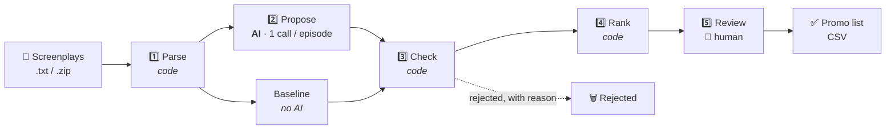
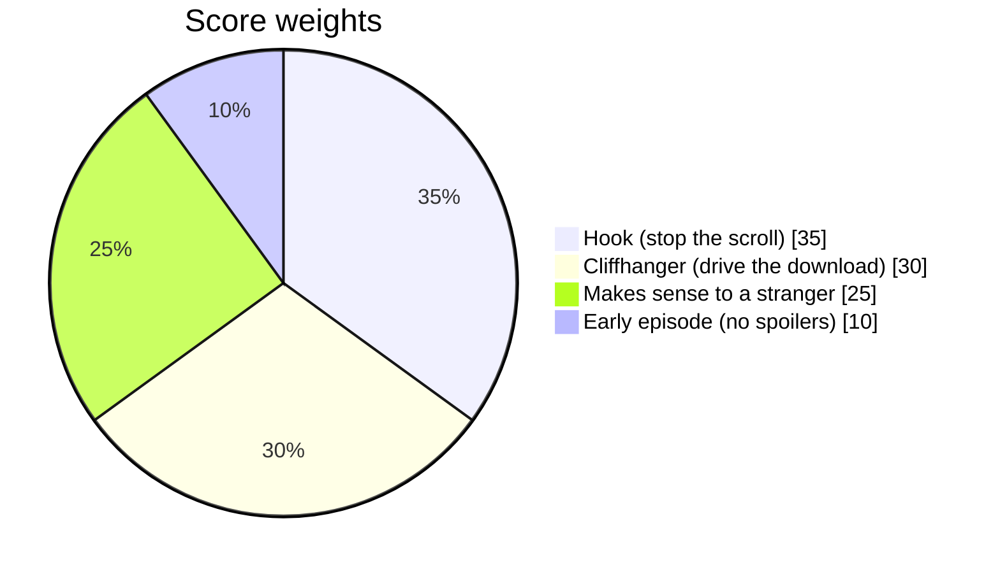
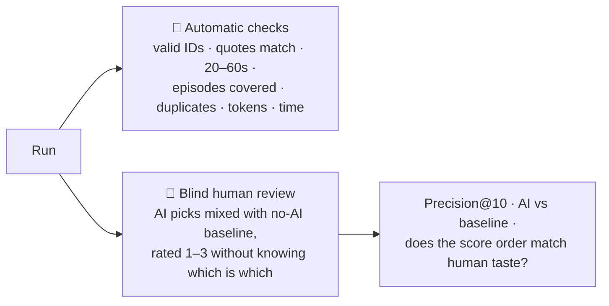
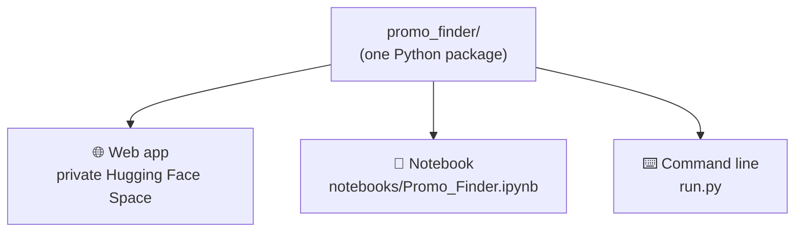
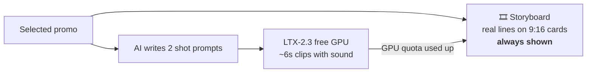

# 🎬 Promo Finder

**Screenplays in → ranked 20–60 second promos out.**
Built for Kuku's AI Generalist assignment (Problem 1).

> **The AI suggests · code checks · a score ranks · a human approves.**

---

## 🤔 The problem

A microdrama show has ~50 short episodes. To advertise it, Kuku needs **promos**: short clips from the show that make a scrolling stranger stop and download the app.

```
 ┌─────────────── a good promo (20–60s) ───────────────┐
 │  0–3s         middle                       last line │
 │  🪝 HOOK  ──▶  builds the situation  ──▶  🧗 CLIFF   │
 │  slap, shock,  a stranger can follow      question,  │
 │  reveal                                   threat,    │
 │                                           unresolved │
 └──────────────────────────────────────────────────────┘
```

Today an editor **watches ~100 minutes** of footage to find them.
This tool **reads the screenplays** and hands the editor a **ranked shortlist with reasons**.

---

## 🗺️ How it works



| Step | Who | What happens | Why it's done this way |
|---|---|---|---|
| **1 Parse** | code | Every line becomes an event with an ID: `E001`, `E002`… plus its real start/end time | IDs let the AI point at lines without writing timestamps |
| **2 Propose** | 🤖 **AI** | Per episode, the AI suggests 0–5 promos as **ID ranges** (`E003 → E012`) + hook, cliffhanger, reason, 1–5 scores | The only step that needs taste. It may return 0, so no filler |
| **3 Check** | code | IDs → real times · never cut mid-line · **reject** if not 20–60s / bad IDs · **flag** slow opens, calm endings, unknown names, recaps, wrong quotes · remove duplicates | Rules that can be checked exactly are free, fast and never hallucinate |
| **4 Rank** | code | Priority score (below) + max 2 promos per episode in the top 10 + a "post first because…" line | Transparent and adjustable |
| **5 Review** | 👤 human | Read the real lines (HOOK 🔴 / CLIFF 🟠), see the score breakdown, **Accept / Reject**, export | The final call stays with the editor |

### Why IDs instead of timestamps?

```
 ❌ AI writes "01:12.30 → 01:46.60"   →  numbers can be misread or invented
 ✅ AI writes "E032 → E042"            →  code looks up the real times from the screenplay
```

**The tool cannot invent a timestamp or a line of dialogue.**

---

## 🧮 The priority score

```
priority = 0.35 × hook  +  0.30 × cliffhanger  +  0.25 × makes-sense-alone  +  0.10 × early-episode  −  flag penalty
```



- Each part = **70% AI opinion + 30% code check**, so the AI can't simply grade itself high.
- Each warning flag costs −0.05 (max −0.15).
- The weights are product judgement, not science. Every run reports how the top 10 changes if a weight moves by ±0.1.

---

## 🧪 How we know it's good



**The no-AI baseline:** microdrama episodes are *written* to end on a cliffhanger, so the simplest tool is "take the last ~35s of each episode". The AI has to beat that to be worth its cost.

---

## 🧰 Three ways to use it



### 🌐 Web app (Hugging Face Space)

```
 ┌──────────────────────────── your browser ────────────────────────────┐
 │  Drop screenplays ─▶ Python runs HERE (Pyodide) ─▶ ranked promos     │
 │                            │                                         │
 │                            └──▶ Groq API (your key, this tab only)   │
 └──────────────────────────────────────────────────────────────────────┘
          The Space only serves the page. No server · no stored keys · no stored files
```

1. Pick a model: **GPT-OSS 120B** (default) · GPT-OSS 20B · Qwen 3.8 27B
2. Drop the episode `.txt` files (or one `.zip`)
3. Paste a Groq key ([free](https://console.groq.com/keys)). **No key?** It runs the no-AI baseline.
4. **Find promos** → browse, accept/reject, download CSV

**▶ Preview promo**: shows how the promo could look:



Ranking and HOOK/CLIFF labels **never** depend on the GPU.

To rebuild or try locally:
```bash
python space/build.py                          # -> space/dist/index.html + README.md
cd space/dist && python -m http.server 8765    # open http://localhost:8765
```

### 📓 Notebook
`notebooks/Promo_Finder.ipynb` contains **all the code** and walks through it stage by stage:
parse → one AI call → check → rank → full run → metrics → video preview.
Runs on Colab, Jupyter or Hugging Face. The Groq key comes from Colab Secrets, an env var or a hidden prompt (press Enter for no-AI mode).

### ⌨️ Command line
```bash
pip install -r requirements.txt
export GROQ_API_KEY=...                                 # free: console.groq.com

python run.py --input show.zip                          # whole show (folder or .zip)
python run.py --input show.zip --episodes 1-5           # quick test
python run.py --input show.zip --montage                # + cross-episode montages
python run.py --input show.zip --provider none          # no AI at all
python -m pytest -q tests
```

**Plug in any model** (no code changes, any OpenAI-compatible endpoint):
```bash
python run.py --input show.zip --provider custom --base-url https://YOUR-ENDPOINT/v1 --model YOUR-MODEL
python run.py --input show.zip --provider openrouter --model <model>
python run.py --input show.zip --provider ollama --model llama3.1:8b
```
Results are cached per (prompt version, model, episode), so an interrupted run resumes for free.

---

## 📦 What a run produces (`outputs/<run>/`)

| File | Contents |
|---|---|
| `promos_ranked.csv / .json` | rank · segments (e.g. `Ep3 00:11.30–00:42.10 [E004–E017]`) · duration · hook & cliffhanger lines · why · priority + parts · flags |
| `baseline_ranked.*` | the no-AI baseline, for comparison |
| `montages_ranked.*` | cross-episode promos (experimental) |
| `rejected.json` | every AI suggestion the checks threw out, with the reason |
| `raw_llm/` | the AI's unedited answers |
| `run_meta.json` | model, tokens, time, cost, score spread, weight sensitivity |

Human review:
```bash
python -m promo_finder.evaluate sheet outputs/<run> path/to/show   # blinded, shuffled rating sheet
python -m promo_finder.evaluate score outputs/<run>                # precision@10, AI vs baseline, rank correlation
```

---

## 📁 Code map

```
promo_finder/
├── parse.py        1️⃣  screenplay → events with IDs
├── prompts.py      2️⃣  the AI instructions (versioned)
├── candidates.py   2️⃣  one AI call per episode + no-AI baseline
├── llm.py              one client for Groq / OpenRouter / OpenAI / Ollama / custom
├── validate.py     3️⃣  snap · reject · flag · dedupe
├── rank.py         4️⃣  priority score · selection · sensitivity
├── pipeline.py         runs 1→4, writes outputs
├── evaluate.py         automatic metrics + blind review sheet
└── preview.py          optional video-preview prompts
space/              web app (one self-contained page)
notebooks/          the walkthrough notebook
run.py              command line
tests/              validator tests (synthetic data only)
```

---

## ⚠️ Known limits

| Limit | What it means |
|---|---|
| 📝 Text only | A look or a silence that plays well on screen is invisible to it |
| ⏱️ Script ≠ final edit | Expect ~±0.5s adjustment by an editor |
| 🎭 Nicknames | "THE FORMER GROOM" = a named character can confuse the "makes sense alone" check |
| 📈 Scores ≠ results | Only real posting data (clicks, watch-through, installs) proves which promo works |

## 📄 Input format
Each `.txt` has an `EPISODE NUMBER` / `EPISODE LOGLINE` header, then blocks like `**SPEAKER (Tone):**`, `**ACTION:**`, `**CAMERA:**`, `**SOUND FX:**`, each followed by `Start: (mm:ss.xx) | End: (mm:ss.xx)`. If a file yields 0 events, the run stops and names the file.

## 🔒 Privacy
Screenplays and run outputs are confidential: never committed, never uploaded to the Space. Keys are never stored in code, files or the Space.
